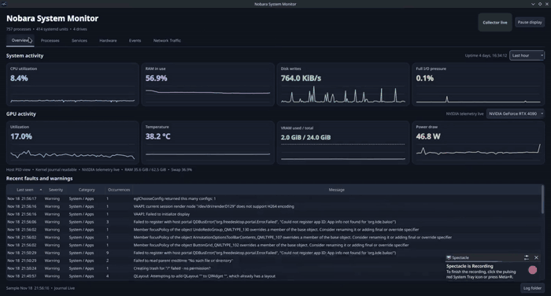

# System Monitoring Tools

Local desktop monitors for Windows and Linux. Both versions offer a live dashboard for CPU, memory, storage, NVIDIA GPU metrics where available, running processes, services, system events, and network activity. History is stored on the computer running the monitor.

| Platform | Download | Source and documentation |
| --- | --- | --- |
| Windows 10/11, x64 | [SystemMonitorSetup.exe](downloads/SystemMonitorSetup.exe?raw=true) | [Windows source](windows/) · [Windows guide](windows/README.txt) |
| Nobara Linux with KDE Plasma | [Nobara-System-Monitor.zip](downloads/Nobara-System-Monitor.zip?raw=true) | [Linux source](linux/) · [Linux guide](linux/README.md) |

## Demo

This walkthrough shows the Nobara Linux dashboard, including live GPU charts, system events, and network activity.

[](docs/demo/system-monitor-demo.mp4)

[Watch or download the full two-minute demo](docs/demo/system-monitor-demo.mp4)

## Windows

1. Download and run `SystemMonitorSetup.exe` on Windows. Internet access is required.
2. Setup reuses a compatible Python installation or downloads and verifies Python from python.org. It installs the dashboard for your account, creates a Start menu shortcut, and starts the background collector at sign-in.
3. To open the dashboard again, search Start for **System Monitor for Windows**.

The installer is unsigned and may show a Windows SmartScreen warning. The Windows monitor was tested in a Windows VM. The [manual Windows package](downloads/System-Monitor-Windows.zip?raw=true) is also available for users who already have Python.

## Linux

1. Extract `Nobara-System-Monitor.zip`.
2. Open a terminal in the extracted `Nobara-System-Monitor` folder and run `bash install.sh`.
3. Open **Nobara System Monitor** from the KDE application menu. The installer creates a user service that records after you close the dashboard. To preview the dashboard from the extracted folder, run `python3 monitor.py`.

The [Linux guide](linux/README.md) lists dependencies and explains the user service.

## Network activity and log access

Both editions show observed remote sockets and associated processes where the operating system provides access. The optional country watchlist uses a local GeoLite2 Country database. Country matches are leads for investigation, since VPNs and hosting services can affect the visible peer address. Windows shows interface traffic totals and peer history. Linux can also show per-peer TCP byte counts when available.

## Build the Windows installer

The [installer source](windows/installer/) includes the native launcher and PowerShell bootstrap. On a Linux build host with Python 3 and LLVM's `clang`, `llvm-dlltool`, `llvm-rc`, and `lld-link`, run:

```bash
bash windows/installer/build.sh
```

The output is `windows/installer/.build/SystemMonitorSetup.exe`. Set `LLVM_BIN` to the LLVM binaries directory if those commands are outside your `PATH`.

[SHA-256 checksums for downloads](downloads/SHA256SUMS)
